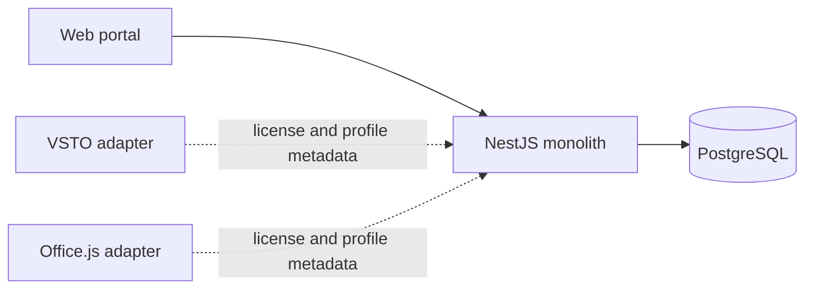

# Kiến trúc E01

OrcaX Office Suite là một modular monolith. Web portal, API và hai adapter Office sau này nói chuyện qua hợp đồng rõ ràng. E01 không tách microservice và không thêm broker, queue hay cơ sở dữ liệu riêng cho từng module.

## Quyết định đã chốt

| Thành phần     | Lựa chọn                                                    |
| -------------- | ----------------------------------------------------------- |
| Cổng thông tin | Next.js 16, JavaScript, giao diện tiếng Việt, desktop-first |
| API            | NestJS 12, TypeScript                                       |
| Kiến trúc      | Một process API, module tách biên giới                      |
| Database       | PostgreSQL 16, schema chỉ đổi bằng migration                |
| ORM            | TypeORM 0.3.31                                              |
| Office         | VSTO và Office.js là hai adapter client, chưa triển khai    |

TypeORM 1.x đã phát hành, nhưng peer ổn định mà `@nestjs/typeorm` 12 công bố là nhánh 0.3. E01 khóa 0.3.31 để Nest và ORM cùng một hợp đồng đã được kiểm tra.

Portal viết bằng JavaScript theo baseline sản phẩm. API viết bằng TypeScript vì đó là mô hình module của NestJS. Hai bên dùng chung `@orcax/api-contracts`, package JavaScript có kèm khai báo kiểu.

## Luồng yêu cầu

1. Mọi request nhận `x-correlation-id`. Header không phải UUID bị thay bằng UUID mới để tránh phá dòng log.
2. `ValidationPipe` chỉ giữ field đã khai báo và từ chối field lạ.
3. API dưới `/api/v1` trả về `{ data, error, meta }`. `meta` có `correlationId` và `apiVersion`.
4. Lỗi không mong đợi trả thông điệp tiếng Việt chung. Chi tiết nội bộ không đưa vào body.
5. `/health` chỉ báo process sống. `/health/ready` kiểm tra PostgreSQL. Hai đường này đứng ngoài prefix và ngoài envelope để probe đọc trực tiếp.

Log là JSON ra stdout. Bản ghi request không gồm query string hay body. Môi trường `development` dùng `pino-pretty` khi package có mặt. Production để `NODE_ENV=production` và giữ log JSON.

## Biên giới module

`AppModule` là composition root duy nhất. Các module nền đã có hành vi: cấu hình, log, database, health, audit.

`IdentityModule`, `OrganizationModule` và `AuthorizationModule` đã có hành vi ở E02. Các module còn lại là vỏ, đăng ký trong `apps/api/src/modules/register-shells.ts` và mô tả trong `module-catalog.ts`. Test biên giới thất bại nếu một vỏ chưa tới epic của nó được thêm controller hoặc provider.

Module không đọc bảng của module khác. Identity và Organization gọi nhau qua service đã export: `WorkspaceService`, `MembershipService`, `UserDirectory`. Authorization không đọc bảng người dùng.

`ProfileModule` / `TemplateModule` (E05) giữ catalogue, phiên bản, legal refs và hợp đồng validation. `WordAutomationModule` / `ExcelAutomationModule` (E06/E07) phục vụ bootstrap add-in và metadata lần chạy. `ConfigurationModule` + phòng ban/nhóm (E08) phục vụ admin overview và cấu hình workspace có lịch sử. `CommerceModule` và `SupportModule` (E09) phục vụ quản lý gói giá, đơn hàng, hóa đơn, thanh toán mock, đối soát, phiếu hỗ trợ kỹ thuật và trung tâm trợ giúp. Mọi lời gọi Office Object Model nằm trong `apps/office-vsto` hoặc `apps/office-js`, trên UI thread của Office. Hai adapter dùng `createRuleResult` trong `@orcax/api-contracts` và báo cáo từ `@orcax/rule-definitions`. Không có assembly .NET dùng chung cho phía JavaScript.

Đường đứt nghĩa là add-in có thể gọi API cho metadata và license. Nội dung tài liệu không đi theo đường đó theo mặc định.

## Dữ liệu

Một database PostgreSQL dùng chung. Ranh giới tenant là `workspace_id`, không phải `organization_id` có thể null. Chi tiết hợp đồng cho E03+ nằm ở [tenancy.md](./tenancy.md).

Mỗi người dùng có đúng một workspace `kind = personal`: `owner_user_id` được gán và `organization_id` để trống. Workspace tổ chức thì ngược lại: có `organization_id` và không có `owner_user_id`. Constraint trong database giữ hai dạng này tách nhau. Workspace cá nhân không chuyển sang trạng thái tạm ngưng. Dữ liệu nghiệp vụ từ E03 trở đi gắn `workspace_id` của workspace đang hoạt động và không đọc chéo sang workspace khác. Đăng nhập luôn kích hoạt workspace cá nhân. Workspace dùng gần nhất chỉ là gợi ý. Chuyển workspace cần `confirmed: true` và một access token mới. Token cũ hết hiệu lực vì `wid` phải trùng `sessions.active_workspace_id`. Tạo tổ chức chỉ khi đang ở personal workspace.

`audit_events` ghi đăng nhập, đăng xuất, xác minh, đặt lại mật khẩu và thay đổi quyền. Bản ghi không chứa mật khẩu, mã, token hay nội dung tài liệu.

`synchronize` luôn tắt. Nguồn schema là `apps/api/src/database/migrations`. Bảng migration tên `schema_migrations`. CLI dùng `src/database/data-source.ts`.

`audit_events` chỉ cho phép `INSERT`. Trigger chặn `UPDATE`, `DELETE` và `TRUNCATE`. Recorder cũng từ chối metadata chứa mật khẩu, token, thông tin thẻ hoặc nội dung tài liệu, và từ chối payload lớn hơn 16 KB. Chưa có API tìm kiếm audit.

## Cấu hình

Biến môi trường được validate lúc khởi động. Thiếu cấu hình database thì process dừng, không thay bằng giá trị ngầm. File duy nhất được nạp là `.env` ở gốc repo. Bí mật không nằm trong source.

`WEB_ORIGIN` bật CORS cho đúng một origin và cho phép cookie phiên. Không đặt origin khi biến trống.

`AUTH_TOKEN_SECRET` bắt buộc, tối thiểu 32 ký tự, không có giá trị mặc định. Access token sống ngắn. Cookie `orcax_session` là phiên refresh, HttpOnly. `EMAIL_TRANSPORT=log` chỉ giữ thư trong bộ nhớ process và chỉ mở `GET /api/v1/dev/mailbox` khi không phải production. Production phải dùng `smtp`.

## Ngoài phạm vi hiện tại

Không có nhà cung cấp thanh toán, chữ ký số, object storage hay metrics. Không có endpoint upload. License chưa gắn vào workspace.
